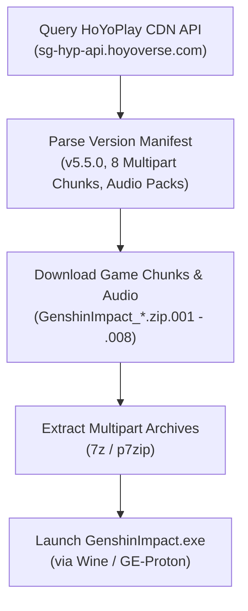

# OpenGenshinInstaller (Native Linux FOSS Downloader & Launcher)

A clean-room, open-source native C++ and Python downloader and launcher for **Genshin Impact** on Linux, reverse-engineered from the official HoYoPlay (`HoYoPlay_install.exe`) client architecture.

---

## Technical Overview

The official `GenshinImpact_install_ua_*.exe` installer is a 229 MB Windows PE binary bundling HoYoPlay's Qt5/CEF frontend. When installed, it connects to HoYoverse's official content delivery APIs to resolve game manifests and download multipart compressed game archives.

`OpenGenshinInstaller` communicates directly with official HoYoverse CDN endpoints without requiring the proprietary Windows installer, CEF web wrappers, or telemetry services.



---

## Features

* **Direct Official CDN Downloads:** Fetches game packages directly from `autopatchhk.yuanshen.com` with parallel connections and HTTP resume support.
* **Audio Language Selection:** Choose which voice packs to download (`en-us`, `ja-jp`, `zh-cn`, `ko-kr`) to save disk space.
* **Multipart Extraction:** Seamlessly unpacks split archives (`.zip.001` through `.zip.008`) directly into your game directory.
* **Zero Telemetry:** Pure downloader with no background telemetry, web trackers, or third-party bloat.
* **Two Implementations Included:**
  * **Native C++17:** High-performance compiled CLI utilizing `libcurl`.
  * **Standalone Python:** Single-file script (`open_genshin.py`) requiring zero compilation.

---

## Usage

### 1. Using the C++ CLI

```bash
# Query latest official version and package details
./build/open-genshin-installer --info

# Download the base game + English voice pack into ~/Games/GenshinImpact
./build/open-genshin-installer --dir ~/Games/GenshinImpact --lang en-us --download

# Extract downloaded packages
./build/open-genshin-installer --dir ~/Games/GenshinImpact --extract

# Launch game via Wine
./build/open-genshin-installer --dir ~/Games/GenshinImpact --run
```

### 2. Using the Standalone Python Script

```bash
# Query latest version
./open_genshin.py --info

# Download and extract into custom folder with Japanese audio
./open_genshin.py --dir ~/Games/GenshinImpact --lang ja-jp --download --extract
```

---

## Linux Wine / Proton Compatibility

Genshin Impact runs natively under modern Wine / Proton without requiring custom patches or anti-cheat modifications.

### Recommended Setup:
1. **Wine Prefix:** Use a clean 64-bit Wine prefix:
   ```bash
   WINEPREFIX=~/.wine-genshin winecfg
   ```
2. **DXVK:** Ensure DXVK is enabled in your Wine prefix for DirectX 11 translation to Vulkan.
3. **Proton / Bottles / Lutris:** You can also point **Bottles** or **Lutris** directly to the extracted folder:
   * Executable: `GenshinImpact.exe`

---

## Building from Source

### Dependencies
* `CMake` (3.16+)
* `C++17` compatible compiler (`g++` or `clang++`)
* `libcurl`
* `p7zip` (for archive extraction)

```bash
cd open-genshin-installer
mkdir build && cd build
cmake ..
make -j$(nproc)
```

---

## License

This project is licensed under the **MIT License** - see the [LICENSE](LICENSE) file for details.
